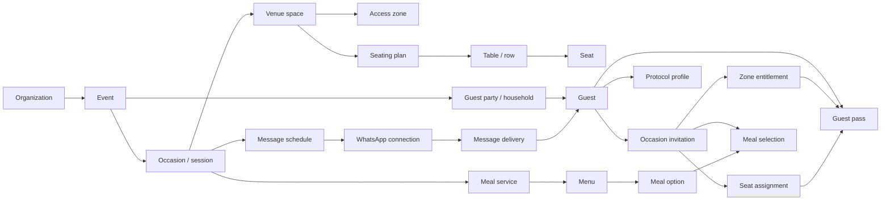
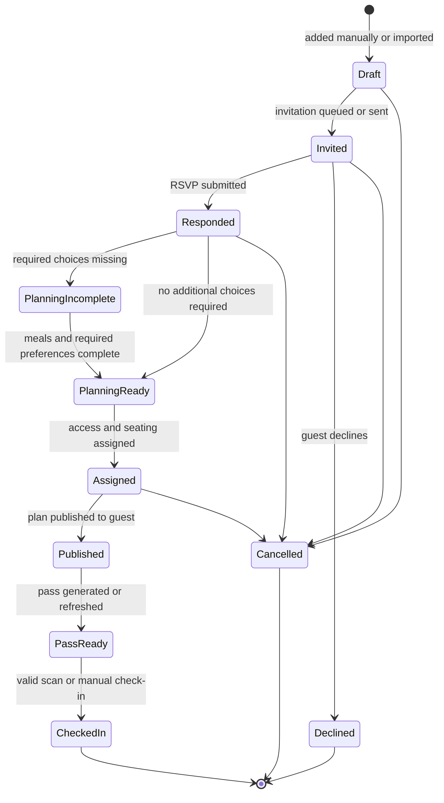
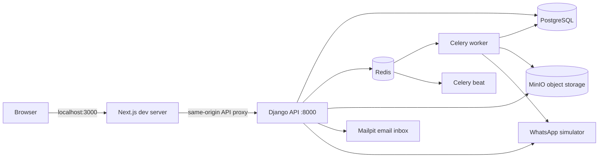
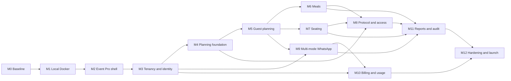

# Event Pro SaaS Build Plan

**Status:** Draft for product and technical review  
**Product:** Event Pro  
**Starting point:** Existing TWS E-GuestPass Django/Next.js application  
**Primary objective:** Evolve the current single-operator event platform into a secure, multi-tenant SaaS product with complete guest-planning operations and a one-command local Docker environment.

---

## 1. Executive summary

Event Pro will be a workspace for event companies, planners, venues, churches, corporate teams, and independent organizers to plan and operate guest-facing events.

The existing product already handles the operational core:

- events and guest lists;
- RSVP workflows;
- guest preferences, plus-ones, Aso Ebi, and celebrant choices;
- branded passes and QR codes;
- WhatsApp invitations, passes, and reminders;
- check-in, delivery tracking, exports, and staff roles.

The rebuild should preserve those working capabilities and introduce four new foundations:

1. **SaaS tenancy:** organizations, memberships, invitations, subscriptions, usage limits, and strict data isolation.
2. **Planning workspace:** event occasions, venue spaces, guest groups, meals, seating, protocol, access zones, and operational reports.
3. **Flexible messaging:** Event Pro-managed WhatsApp, dedicated managed numbers, and customer-connected WhatsApp accounts.
4. **Local-first delivery:** the complete application runs with Docker, includes realistic demo data, and exposes every milestone for inspection.

This is an evolutionary refactor. Replacing Django, Next.js, PostgreSQL, Redis, or Celery is outside the plan unless implementation exposes a concrete blocker.

---

## 2. Product principles

1. **Working operations before decorative dashboards.** The first viewport of an event should expose its current planning state and next actions.
2. **Simple events stay simple.** A birthday should not require a conference-sized setup. Planning modules are enabled only when needed.
3. **Draft before publish.** Seating, access, schedules, and guest-facing changes remain private until an authorized manager publishes them.
4. **Separate concepts that change independently.** Guest category, ticket type, access, seating, and protocol status must not be one overloaded field.
5. **Tenant isolation is enforced by the backend.** Hiding records in the frontend is never considered authorization.
6. **Guest information is collected once and reused.** RSVP, meals, access, passes, seating, and check-in share one guest profile.
7. **Event-day workflows tolerate poor connectivity and pressure.** Check-in and lookup screens prioritize speed, clarity, and recoverability.
8. **Every milestone is locally inspectable.** Each product slice must compile, start through Docker, include representative demo data, and preserve the last working experience.

---

## 3. Goals and release boundaries

### 3.1 SaaS MVP goals

- Self-service account and organization creation.
- Team invitations and organization-scoped roles.
- Event creation from an event-type preset or a custom configuration.
- Multi-occasion events with spaces and access zones.
- Guest categories, tags, households, delegations, and plus-ones.
- Meal choice and dietary-information collection through RSVP/preferences.
- Table and seat configuration with draft and published assignments.
- Honoured-guest and protocol planning.
- Flexible WhatsApp sending modes.
- QR passes and zone-aware check-in.
- Planning dashboards and vendor-ready exports.
- Plans, subscriptions, usage tracking, and backend-enforced entitlements.
- Complete local Docker environment.

### 3.2 Deferred until after SaaS MVP

- Automatic or AI seating optimization.
- Free-form floor-plan drawing or CAD import.
- Native mobile applications.
- Full vendor marketplace.
- Hotel, transport, budget, procurement, and inventory management.
- WhatsApp registration bot.
- Continuous Google Sheets synchronization.
- Complex white-label domains and reseller hierarchy.
- Multi-region active-active infrastructure.

The data model should not block these features, but the MVP must not implement them speculatively.

---

## 4. Users and responsibilities

### 4.1 Product personas

| Persona | Primary objective |
| --- | --- |
| Organization owner | Configure the account, subscription, team, branding, and integrations |
| Event manager | Own the complete event plan and publish guest-facing changes |
| Guest coordinator | Manage invitations, RSVP, guest data, households, and communication |
| Seating coordinator | Configure spaces, tables, seats, and assignments |
| Catering coordinator | Configure meal services and prepare final meal/allergy counts |
| Protocol officer | Manage honoured guests, escorts, arrival plans, and restricted notes |
| Communications manager | Manage approved templates, delivery schedules, and campaign health |
| Check-in supervisor | Configure stations, resolve exceptions, and monitor arrivals |
| Scanner | Validate access and check guests in without seeing unnecessary private data |
| Vendor viewer | Read a narrowly scoped operational report without full guest access |
| Event Pro operator | Support organizations and operate managed WhatsApp services without becoming a tenant member |

### 4.2 Authorization layers

Authorization has four distinct layers:

1. **Platform role:** Event Pro support or platform administration.
2. **Organization membership:** owner, administrator, manager, billing, or viewer.
3. **Event assignment:** the events a team member may access.
4. **Feature permission:** guest data, meals, seating, protocol, communications, reports, or check-in.

Platform access must not be represented by the same role field used for customer permissions.

---

## 5. Complete product architecture

```mermaid
flowchart TB
    subgraph PEOPLE[People]
        Owner[Organization owner]
        Manager[Event manager]
        Coordinators[Guest / Seating / Catering / Protocol teams]
        Checkin[Check-in staff]
        Guest[Guest or party member]
        Vendor[Approved vendor]
        Operator[Event Pro operator]
    end

    subgraph EXPERIENCE[Event Pro experiences]
        Marketing[Marketing, pricing and signup]
        Workspace[Organization workspace]
        Planning[Event planning workspace]
        GuestPortal[Guest RSVP and preferences]
        Pass[Digital pass]
        Scanner[Check-in scanner]
        VendorView[Restricted vendor reports]
        PlatformOps[Platform operations console]
    end

    subgraph APPLICATION[Application services]
        Next[Next.js web application]
        API[Django REST API]
        Auth[Identity, tenancy and permissions]
        EventSvc[Event and occasion planning]
        GuestSvc[Guest, party and preference management]
        MealSvc[Meal planning and dietary reporting]
        SeatSvc[Seating plans and assignments]
        ProtocolSvc[Protocol and access control]
        MessageSvc[Messaging orchestration]
        BillingSvc[Plans, entitlements and usage]
        ReportSvc[Exports, manifests and print views]
        AuditSvc[Audit and operational history]
    end

    subgraph ASYNC[Background processing]
        Redis[(Redis)]
        Worker[Celery workers]
        Beat[Celery scheduler]
        Imports[Import queue]
        Assets[Pass and QR asset queue]
        Messages[Message delivery queue]
    end

    subgraph DATA[Data and files]
        Postgres[(PostgreSQL)]
        Objects[(S3-compatible object storage)]
    end

    subgraph EXTERNAL[External systems]
        Meta[Meta WhatsApp Cloud API]
        Payment[Payment provider]
        Email[Transactional email provider]
    end

    Owner --> Marketing
    Owner --> Workspace
    Manager --> Planning
    Coordinators --> Planning
    Checkin --> Scanner
    Guest --> GuestPortal
    Guest --> Pass
    Vendor --> VendorView
    Operator --> PlatformOps

    Marketing --> Next
    Workspace --> Next
    Planning --> Next
    GuestPortal --> Next
    Pass --> Next
    Scanner --> Next
    VendorView --> Next
    PlatformOps --> Next
    Next --> API

    API --> Auth
    API --> EventSvc
    API --> GuestSvc
    API --> MealSvc
    API --> SeatSvc
    API --> ProtocolSvc
    API --> MessageSvc
    API --> BillingSvc
    API --> ReportSvc
    API --> AuditSvc

    Auth --> Postgres
    EventSvc --> Postgres
    GuestSvc --> Postgres
    MealSvc --> Postgres
    SeatSvc --> Postgres
    ProtocolSvc --> Postgres
    BillingSvc --> Postgres
    AuditSvc --> Postgres
    ReportSvc --> Postgres
    GuestSvc --> Objects
    ReportSvc --> Objects

    API --> Redis
    Beat --> Redis
    Redis --> Worker
    Worker --> Imports
    Worker --> Assets
    Worker --> Messages
    Imports --> Postgres
    Assets --> Postgres
    Assets --> Objects
    Messages --> Meta
    MessageSvc --> Meta
    BillingSvc --> Payment
    Auth --> Email
```



---

## 6. Event planning hierarchy



### 6.1 Core distinctions

| Concept | Meaning |
| --- | --- |
| Event | The customer-facing event project, such as a wedding or conference |
| Occasion | A timed part of the event, such as ceremony, reception, dinner, or after-party |
| Space | A physical room, hall, garden, entrance, or virtual location used by an occasion |
| Zone | A controlled access area within an occasion or space |
| Guest category | The guest's relationship or operational classification: family, VIP, speaker, sponsor, media |
| Ticket type | The admission product or service level assigned to the guest |
| Party | A household, couple, family, delegation, or group managed together |
| Seating assignment | Where the guest is expected to sit for one occasion |
| Access entitlement | Where the guest is permitted to enter |
| Protocol profile | Internal handling instructions for an honoured or sensitive guest |

---

## 7. Guest lifecycle



Status values used for delivery, RSVP, meal completion, seating, access, and check-in should remain separate in the database. The lifecycle above is a computed planning view, not one overloaded status column.

---

## 8. Functional scope

### 8.1 Organization and SaaS administration

- Create an organization during signup.
- Invite and remove team members.
- Assign organization and event permissions.
- Switch organizations when a user belongs to more than one.
- Configure organization name, logo, timezone, locale, and defaults.
- View plan, usage, invoices, and subscription state.
- Configure messaging connections and approved domains.
- View audit history appropriate to the user's permission.

### 8.2 Event creation

Event creation uses a short guided flow:

1. Identity: name, event type, owner, timezone.
2. Schedule: first occasion, date, time, and venue.
3. Guest model: categories, party behavior, required fields, plus-ones.
4. Planning modules: meals, seating, access, RSVP, WhatsApp, protocol.
5. Initial delivery plan: invite first or send passes directly.

Presets supply sensible defaults for weddings, birthdays, conferences, corporate events, galas, religious events, memorials, concerts, private dinners, and custom events. A preset copies configuration into the event and does not create a permanent behavioral dependency.

### 8.3 Occasions and program

- One or more occasions per event.
- Independent date, time, venue, capacity, RSVP requirement, and status.
- Optional schedule entries within an occasion.
- Guests may be invited to all or selected occasions.
- Each occasion may have its own seating plan, meal services, access zones, and communication schedule.

### 8.4 Guest planning

- Individual entry, CSV import, and later spreadsheet integration.
- Configurable guest categories and tags.
- Party/household management with one primary contact.
- Named and unnamed plus-ones.
- Occasion-specific invitations.
- Internal owner or host responsible for the guest.
- Custom operational notes with permission restrictions.
- Duplicate detection using normalized phone/email plus a review queue.
- Bulk actions that preview their impact before committing.

### 8.5 Meal planning

- Meal services attached to an occasion.
- Menus and meal options for adult, child, VIP, staff, vendor, or custom audiences.
- Per-option availability and capacity where needed.
- Selection deadlines and manager-controlled locking.
- Choices for a guest and each named party member.
- Dietary classifications, allergies, and assistance notes.
- Missing-choice reminders.
- Totals by option, dietary type, occasion, category, table, and service.
- Catering exports that omit unrelated guest information.

### 8.6 Seating planning

- Spaces with capacity.
- Plans with `draft`, `published`, `archived`, and version metadata.
- Tables, theatre rows, or named seating groups.
- Table shape, capacity, label, zone, and position metadata.
- Optional exact seats.
- Guest or party assignment.
- Locked assignments.
- Together/apart preferences and accessibility requirements.
- Over-capacity, duplicate, missing, and inaccessible-seat warnings.
- Publish action separated from ordinary save.
- Table manifests, place cards, and unassigned-guest reports.

The MVP visual editor should support table cards and drag/drop assignment. A free-form graphical floor-plan editor is deferred.

### 8.7 Honoured guests and protocol

- Configurable honour/protocol tiers.
- Honorific and formal name.
- Liaison, escort, and arrival contact.
- Arrival time, entrance, parking, holding area, and security instructions.
- Stage, award, speaking, or presentation duties.
- Hospitality, gift, and special service requirements.
- Priority check-in and private internal notes.
- Field-level or section-level permission control.
- Protocol schedule and arrival manifest.

Guest-facing labels must be explicitly configured; internal labels such as `VVIP` should not appear automatically.

### 8.8 Access and passes

- Invitations determine eligible occasions.
- Entitlements determine eligible zones and entrances.
- Seating does not automatically grant access unless configured.
- Pass design can display occasion, table, seat, or category when published.
- QR validation includes organization, event, occasion/zone rules, and revocation state.
- Scanner stations may be restricted to one occasion, entrance, or zone.
- Scanner users see the minimum information required to make an entry decision.

### 8.9 Flexible WhatsApp operation

Each organization may have one or more connections:

| Mode | Operation |
| --- | --- |
| Event Pro managed | Uses an Event Pro-owned shared number and locked approved templates |
| Dedicated managed | Uses a dedicated number operated by Event Pro for that customer |
| Customer connected | Customer connects its own WABA and phone number through supported Meta onboarding |

Rules for the shared managed service:

- Approved Event Pro templates only.
- No customer-authored free-form messages.
- Controlled variables and approved media.
- Recorded invitation/consent basis and suppression handling.
- Per-organization quotas, pacing, monitoring, and suspension.
- Clear identification of Event Pro and the event organizer.

Events select a default connection. Every scheduled or sent message stores the immutable connection used, allowing an organization to switch later without corrupting delivery history.

### 8.10 Billing and entitlements

- Product plans define capabilities and limits.
- Subscription status comes from verified, idempotent provider webhooks.
- Backend services enforce limits before mutations or queueing.
- Usage dimensions initially cover active events, guests, team seats, managed WhatsApp sends, and storage.
- Plan changes never delete customer data automatically.
- Exceeded limits prevent additional consumption while preserving read/export access.

Payment-provider choice remains an implementation decision. The billing domain must not leak provider-specific objects into events or guests.

---

## 9. Proposed domain model

### 9.1 Tenancy and identity

| Model | Key fields and relationships |
| --- | --- |
| `Organization` | name, slug, logo, timezone, locale, status, created_by |
| `Membership` | organization, user, organization_role, status, joined_at |
| `OrganizationInvitation` | organization, email, role, token_hash, expires_at, invited_by, accepted_at |
| `EventTeamAssignment` | event, membership, feature permissions, status |
| `AuditLog` | organization, actor, action, target type/id, metadata, request id, timestamp |

### 9.2 SaaS and integrations

| Model | Key fields and relationships |
| --- | --- |
| `Plan` | code, name, entitlements, limits, active |
| `Subscription` | organization, plan, provider, provider IDs, status, trial and billing dates |
| `UsageLedger` | organization, dimension, quantity, source, period, idempotency key |
| `WhatsAppConnection` | organization, mode, WABA ID, phone-number ID, encrypted credential reference, display identity, status, billing owner, default |
| `MessageTemplate` | organization/managed scope, connection/WABA, Meta name, language, category, variables, status |
| `MessageDelivery` | organization, event, guest, connection, template, state, provider message ID, timestamps, error details |

### 9.3 Event structure

| Model | Key fields and relationships |
| --- | --- |
| `EventTypePreset` | platform or organization scope, name, default module configuration |
| `Event` | organization, name, type, owner, timezone, description, module configuration, lifecycle status |
| `EventOccasion` | event, name, start/end, venue, capacity, status, ordering |
| `VenueSpace` | occasion, name, address/description, capacity |
| `AccessZone` | occasion, space, name, capacity, entry rules |

### 9.4 Guests and invitations

| Model | Key fields and relationships |
| --- | --- |
| `GuestCategory` | event, name, color/token, planning defaults |
| `GuestTag` | event, name |
| `GuestParty` | event, name, primary guest, party type |
| `Guest` | event, party, category, contact data, host owner, status, existing preference/check-in fields |
| `GuestTagAssignment` | guest, tag |
| `OccasionInvitation` | occasion, guest, RSVP state, invitation state, response timestamps |
| `ZoneEntitlement` | occasion invitation, zone, valid-from/to, status |

### 9.5 Meals

| Model | Key fields and relationships |
| --- | --- |
| `MealService` | occasion, name, service time, deadline, status |
| `Menu` | meal service, name, audience/category rules |
| `MealOption` | menu, name, description, dietary flags, capacity, active |
| `MealSelection` | meal service, guest/party member, option, dietary notes, source, submitted_at, locked_at |

### 9.6 Seating

| Model | Key fields and relationships |
| --- | --- |
| `SeatingPlan` | occasion/space, name, version, state, published_at/by |
| `SeatingUnit` | plan, type, label, shape, capacity, zone, position metadata |
| `Seat` | seating unit, label, order, accessibility attributes |
| `SeatingAssignment` | plan, guest, seating unit, optional seat, locked, assigned_by/at |
| `SeatingConstraint` | plan/event, guest or party references, type, strength, notes |

### 9.7 Protocol

| Model | Key fields and relationships |
| --- | --- |
| `ProtocolTier` | event, name, priority, handling defaults |
| `GuestProtocol` | guest, tier, honorific, liaison, arrival and security details, confidential notes |
| `ProtocolDuty` | occasion, guest, duty type, schedule, location, instructions |

### 9.8 Important database rules

- Customer-owned top-level records carry `organization_id` directly.
- Child records must be reachable only through a parent in the same organization.
- Unique constraints include organization/event scope where relevant.
- Cross-organization relationships are rejected by service validation and tested explicitly.
- Public identifiers use non-sequential random tokens; internal numeric IDs are not accepted as public authorization.
- Published versions are immutable snapshots where operational history matters.
- Provider webhook records and usage-ledger entries use idempotency constraints.

---

## 10. Application information architecture

### 10.1 Public routes

```text
/
/pricing
/login
/signup
/forgot-password
/accept-invitation/[token]
/r/[code]
/[eventSlug]/rsvp/[guestCode]
/preferences/[code]
/pass/[code]
/scan/[stationCode]
```

### 10.2 Customer application

```text
/app
/app/events
/app/events/new
/app/events/[eventId]
/app/events/[eventId]/program
/app/events/[eventId]/guests
/app/events/[eventId]/rsvp
/app/events/[eventId]/meals
/app/events/[eventId]/seating
/app/events/[eventId]/protocol
/app/events/[eventId]/access
/app/events/[eventId]/communications
/app/events/[eventId]/check-in
/app/events/[eventId]/reports
/app/team
/app/integrations/whatsapp
/app/billing
/app/settings
```

Existing `/admin` routes should remain available during migration and redirect only after functional parity is verified.

### 10.3 Platform operations

```text
/platform/organizations
/platform/subscriptions
/platform/managed-messaging
/platform/delivery-health
/platform/support-audit
```

The platform console uses separate authorization and must not rely on customer `super_admin` roles.

---

## 11. API and service boundaries

The existing Django REST structure remains, but domain services should own multi-record operations.

| Domain | Representative endpoints/actions |
| --- | --- |
| Identity | signup, login/logout, verify email, password reset, current user |
| Organizations | CRUD, members, invitations, active-organization context |
| Events | CRUD, clone from preset, archive, publish configuration |
| Program | occasions, spaces, zones, schedule entries |
| Guests | CRUD, parties, categories, tags, import, deduplication, export |
| RSVP | workflows, recipients, responses, reminders, preference completion |
| Meals | services, menus, options, selections, lock, counts, exports |
| Seating | plans, units, seats, assignments, constraints, validate, publish, archive |
| Protocol | tiers, profiles, duties, manifests |
| Access | entitlements, stations, validation, check-in, revocation |
| Messaging | connections, templates, schedules, queue, resend, delivery status |
| Billing | subscription, portal, webhook, entitlements, usage summary |
| Reporting | asynchronous export jobs and download tokens |

### 11.1 Request organization context

- The organization is resolved from the authenticated membership and explicit active-organization selection.
- The API never trusts a client-supplied organization ID without validating membership.
- Queryset helpers and domain services apply organization scope centrally.
- Public guest endpoints resolve organization through signed/random guest-facing tokens.
- Celery jobs include organization and immutable target identifiers, then revalidate ownership when executing.

---

## 12. Local Docker architecture



### 12.1 Default services

- `frontend`: Next.js development server with source mounting and hot reload.
- `backend`: Django development server with source mounting.
- `postgres`: local PostgreSQL matching production major version.
- `redis`: Celery broker and short-lived coordination.
- `worker`: default Celery worker; specialist queues can be enabled through profiles.
- `beat`: scheduled jobs.
- `minio`: S3-compatible local object storage.
- `mailpit`: email inspection for invitations and password resets.
- `whatsapp-simulator`: records outbound template payloads and accepts delivery/read/failure simulations.

### 12.2 Required commands

```powershell
Copy-Item .env.example .env
docker compose up --build
docker compose exec backend python manage.py seed_demo
docker compose test
```

The default local URLs should be:

- Product: `http://localhost:3000`
- API: `http://localhost:8000`
- Mail inspection: `http://localhost:8025`
- Object-store console: `http://localhost:9001`
- WhatsApp simulator: documented local URL selected during implementation

The existing frontend `3003` development-port mismatch should be removed. The product URL is standardized on port `3000`.

### 12.3 Demo organization

The seed command creates an idempotent scenario:

- Event Pro demo organization.
- Owner and coordinators for meals, seating, protocol, and check-in.
- A wedding with ceremony, reception, and after-party occasions.
- Family, VIP, speaker/vendor, and general guest categories.
- Guest parties, meal selections, dietary examples, honoured guests, and incomplete responses.
- Draft and published seating plans.
- Access zones and scanner stations.
- Event Pro-managed WhatsApp simulation with sent, delivered, read, and failed messages.
- Subscription and usage data.

This scenario becomes the first local review surface for every milestone.

---

## 13. Data migration strategy

Production data must be preserved through expand-and-contract migrations.

### 13.1 Tenancy migration

1. Create tenancy tables without changing current reads.
2. Create one legacy organization.
3. Add existing users as memberships with mapped roles.
4. Add nullable organization foreign keys to customer-owned top-level models.
5. Backfill all existing records into the legacy organization.
6. Add organization-aware indexes and constraints.
7. Switch API reads and writes to scoped services.
8. Run tenant-isolation tests and data reconciliation.
9. Make organization relationships non-null where appropriate.

### 13.2 Event-structure migration

1. Create a default occasion for each existing event using its current date and venue.
2. Preserve current event fields during the compatibility period.
3. Attach current RSVP, reminders, and pass delivery to the default occasion where required.
4. Create one default venue space when existing seating data is present.
5. Convert distinct `table_number` values into seating units.
6. Convert `seat_number` values into seats where the mapping is unambiguous.
7. Generate a reconciliation report for blank, duplicated, or ambiguous legacy assignments.
8. Keep legacy fields read-only until the new planning workspace reaches parity.

### 13.3 Messaging migration

1. Create an Event Pro-managed connection for current global Meta credentials.
2. Attach existing templates and delivery history to that connection.
3. Replace runtime access to global WhatsApp settings with connection resolution.
4. Retain environment variables only for bootstrapping or secret-provider configuration.

### 13.4 Rollback discipline

- Migrations avoid destructive column removal in the same release that changes application reads.
- Each backfill produces record counts and exception reports.
- Media keys are copied or re-referenced before legacy paths are removed.
- Database backups and restoration rehearsal are release gates for production migration.

---

## 14. Delivery plan

Calendar duration depends on team size and review speed. The sequence below is the implementation order and dependency plan.

### Milestone 0 — Baseline and safety net

**Outcome:** The current application has a measurable, reproducible baseline.

Work:

- Run and stabilize existing backend tests.
- Add smoke coverage for login, event creation, guest creation, RSVP, pass generation, WhatsApp queueing, and check-in.
- Record database/media migration fixtures.
- Document current roles, endpoints, queues, and scheduled tasks.
- Remove accidental secrets and align environment examples.

Acceptance:

- Baseline test command is documented and repeatable.
- Known failures are documented rather than silently ignored.
- A representative legacy fixture can be restored for migration testing.

### Milestone 1 — Full local Docker environment

**Outcome:** A new developer or reviewer can run the complete product locally with one command.

Work:

- Replace the Redis-only root compose file with the development stack.
- Add health checks, volumes, source mounting, and dependency ordering.
- Add MinIO, Mailpit, and WhatsApp simulator.
- Add idempotent migrations and demo seeding.
- Standardize ports and same-origin local API access.

Acceptance:

- Fresh checkout starts without local Python or Node installations.
- Frontend and backend edits reload without rebuilding every service.
- Restarting containers preserves database and demo media.
- Email and WhatsApp output can be inspected locally.

### Milestone 2 — Event Pro identity and application shell

**Outcome:** The product consistently presents as Event Pro.

Work:

- Replace TWS E-GuestPass names, metadata, descriptions, package labels, database defaults, and documentation.
- Define Event Pro visual tokens and application navigation.
- Establish public marketing, authentication, customer application, and platform-operation shells.
- Preserve existing operational routes while new `/app` routes are built.

Acceptance:

- No customer-facing legacy branding remains.
- Existing product workflows remain accessible.
- Metadata, login, navigation, email, and generated content use Event Pro.

### Milestone 3 — Tenancy, authentication, and team permissions

**Outcome:** Multiple organizations can use one deployment without seeing each other's data.

Work:

- Add organizations, memberships, invitations, and active organization context.
- Separate platform roles from organization roles.
- Implement signup, verification, password reset, and team invitation flows.
- Scope existing events, guests, RSVP, templates, fonts, reminders, uploads, and users.
- Add cross-tenant access tests for all sensitive endpoints and background tasks.

Acceptance:

- Two demo organizations cannot access each other's records by list, filter, guessed ID, export, task, media URL, or public token.
- Existing production data maps to the legacy organization.
- A user can belong to and switch between multiple organizations.

### Milestone 4 — Event structure and planning foundation

**Outcome:** Event managers can model event types, occasions, spaces, zones, guest categories, and parties.

Work:

- Add presets, occasions, spaces, access zones, categories, tags, and parties.
- Build the event creation flow and planning overview.
- Migrate existing event date/venue data to default occasions.
- Add event-specific team assignments.

Acceptance:

- Simple single-occasion and multi-occasion events are both supported.
- Modules can be enabled or disabled without deleting data.
- Guests can belong to a party and be invited to selected occasions.

### Milestone 5 — Guest planning and RSVP integration

**Outcome:** Guest information and planning requirements are collected through one coherent lifecycle.

Work:

- Extend guest forms, imports, filters, categories, tags, parties, and occasion invitations.
- Connect RSVP responses to occasion-level invitations.
- Add completion indicators and missing-information segments.
- Preserve current plus-one, Aso Ebi, celebrant, and preferences behavior.

Acceptance:

- Coordinators can identify every guest awaiting RSVP or required planning data.
- Named party members retain independent preferences where necessary.
- Existing public RSVP links continue to resolve during migration.

### Milestone 6 — Meal planning

**Outcome:** Managers can collect meal choices and produce reliable catering counts.

Work:

- Add meal services, menus, options, selections, dietary flags, deadlines, and locking.
- Extend RSVP/preferences for guest and party-member selections.
- Build catering overview, outstanding-choice segments, and exports.
- Add permission restrictions for sensitive dietary notes.

Acceptance:

- Totals reconcile with individual selections.
- Locked selections cannot be changed through public or unauthorized routes.
- Caterer exports contain only approved fields.
- Counts can be grouped by option, table, occasion, and guest category.

### Milestone 7 — Seating planning

**Outcome:** Coordinators can create, validate, publish, and export seating plans.

Work:

- Add plans, units, seats, assignments, constraints, and version states.
- Build table/row configuration and drag/drop guest assignment.
- Add capacity, duplication, accessibility, and missing-assignment validation.
- Add publish, archive, history, and guest notification integration.
- Migrate existing table/seat strings with reconciliation reporting.

Acceptance:

- Draft changes are invisible to guests.
- Publishing creates an immutable operational version.
- No guest can occupy two seats in one plan.
- Over-capacity and unassigned states are clearly surfaced.

### Milestone 8 — Protocol, access, passes, and event-day operations

**Outcome:** Honoured guests and restricted event areas are planned without exposing sensitive information.

Work:

- Add protocol tiers, profiles, duties, and manifests.
- Add occasion/zone entitlements and scanner-station restrictions.
- Update passes to use published occasion, seating, and access information.
- Update check-in to validate the station's event, occasion, and zone.
- Add priority and exception-handling flows.

Acceptance:

- A valid event pass cannot enter a zone it was not granted.
- Scanner users cannot retrieve protocol notes or unrelated guest data.
- Revoked or superseded passes fail safely.
- Protocol officers can produce an ordered arrival schedule.

### Milestone 9 — Multi-mode WhatsApp

**Outcome:** Organizations can begin with Event Pro managed delivery and later use a dedicated or customer-owned number.

Work:

- Replace global settings with tenant-aware connections.
- Implement managed, dedicated managed, and connected modes.
- Route templates, queues, webhooks, replies, and delivery status by connection.
- Add quotas, suppression, compliance evidence, and platform controls.
- Implement supported embedded onboarding after required Meta application approval is available.

Acceptance:

- Switching defaults affects only newly scheduled messages.
- Every delivery is attributable to one organization and connection.
- Shared mode rejects free-form content and unauthorized templates.
- One organization's pause does not stop another organization's dedicated/connected queue.

### Milestone 10 — Plans, subscriptions, and usage

**Outcome:** Event Pro can sell and enforce SaaS plans.

Work:

- Add plans, entitlements, subscriptions, usage ledger, checkout/portal, and provider webhooks.
- Add managed-message credits and overage rules.
- Enforce limits in backend services and asynchronous queueing.
- Build billing and usage screens.

Acceptance:

- Replayed billing webhooks do not duplicate state or usage.
- Plan limits cannot be bypassed through direct API calls.
- Losing an entitlement does not delete existing customer data.
- Billing and message usage reconcile to ledger entries.

### Milestone 11 — Reporting, audit, and collaboration

**Outcome:** Teams and vendors receive accurate operational outputs with traceable changes.

Work:

- Add asynchronous report jobs and expiring downloads.
- Add seating, catering, protocol, access, RSVP, delivery, and arrival reports.
- Add audit history for sensitive mutations and publishing.
- Add restricted vendor views and exports.

Acceptance:

- Large exports do not block web requests.
- Export authorization is rechecked at download time.
- Published plan changes identify actor, time, and affected records.

### Milestone 12 — Hardening and launch readiness

**Outcome:** The SaaS product is secure, observable, recoverable, and deployable.

Work:

- Restore CSRF enforcement and complete cookie/session hardening.
- Add throttling, upload validation, secret encryption, media authorization, and retention policies.
- Add structured logs, error monitoring, queue health, delivery metrics, and alerts.
- Load-test imports, generation, message bursts, RSVP submissions, and check-in.
- Rehearse backups, restores, data migration, and rollback.
- Complete accessibility and responsive review.

Acceptance:

- Critical security and tenant-isolation tests pass.
- Backup restoration is demonstrated.
- Queue degradation does not corrupt data or duplicate sends.
- Launch runbook, support runbook, and incident ownership are documented.

---

## 15. Dependency map



Meals and seating can be developed in parallel after guest planning is stable. Multi-mode messaging can proceed in parallel with planning modules after tenancy is complete.

---

## 16. Testing strategy

### 16.1 Backend

- Model and domain-service unit tests.
- API permission and validation tests.
- Cross-tenant list/detail/filter/export/media tests.
- Celery retry, idempotency, and organization-context tests.
- Migration tests using representative legacy fixtures.
- Provider webhook signature and replay tests.
- Property or invariant tests for seating capacity and duplicate assignments where useful.

### 16.2 Frontend

- Component tests for planning controls and states.
- Route-level error, loading, empty, success, permission, and limit states.
- End-to-end flows for signup, event setup, RSVP, meals, seating publish, WhatsApp simulation, pass generation, and check-in.
- Keyboard and screen-size coverage for the planning workspace and scanner.

### 16.3 Operational and load tests

- Large CSV import.
- Bulk pass generation.
- Scheduled invitation burst.
- Public RSVP surge.
- Concurrent scanner stations.
- Export generation and media downloads.
- Worker termination and retry recovery.

### 16.4 Required release gates

- Backend tests pass.
- Frontend production build passes.
- Database migration dry run passes against a restored legacy snapshot.
- Tenant-isolation suite passes.
- Critical end-to-end journey passes in Docker.
- No new high-severity dependency or application security finding remains unowned.

---

## 17. Security and privacy requirements

- Restore standard CSRF protection; CORS and HTTPS are not substitutes.
- Prefer same-origin secure cookies for browser authentication.
- Encrypt integration credentials and never return them through serializers.
- Keep protocol, allergy, and security notes behind specific permissions.
- Store normalized phone identifiers for matching while preserving display formatting.
- Validate and scan uploaded fonts, images, CSV files, and documents.
- Use signed or authorized media delivery rather than public predictable paths.
- Record consent/invitation basis and opt-out suppression for managed WhatsApp.
- Rate-limit public RSVP, preference, pass, and scan endpoints.
- Audit impersonation/support access and sensitive exports.
- Define retention and deletion behavior per organization and data category.

---

## 18. Definition of done for every milestone

A milestone is complete only when:

1. Database migrations are reversible or follow the documented expand/contract path.
2. Backend authorization and validation are implemented, not merely frontend restrictions.
3. Loading, empty, error, success, and permission-denied states are present.
4. Relevant tests pass locally in Docker.
5. Representative demo data exposes the feature for review.
6. Existing working flows remain available or have verified parity.
7. User-facing metadata and help text are updated.
8. Audit, usage, and background-job implications are handled.
9. The product build succeeds.
10. The change is inspectable through the stable local Event Pro URL.

---

## 19. Decisions to close before affected milestones

| Decision | Needed before | Recommended starting position |
| --- | --- | --- |
| Payment provider | Milestone 10 | Hide behind a provider adapter; select based on launch market and settlement needs |
| Shared WhatsApp commercial terms | Milestone 9 | Approved customers only, locked utility templates, included credits plus overage |
| Dedicated-number operating model | Milestone 9 | Manual onboarding first, automate only after operational experience |
| Exact plan limits | Milestone 10 | Measure demo/pilot usage before fixing public limits |
| Vendor access model | Milestone 11 | Expiring, least-privilege views rather than full organization membership |
| Data-retention defaults | Milestone 12 | Preserve operational records; configurable deletion for media and sensitive notes |

---

## 20. Recommended first implementation release

The first release should stop after Milestone 3 and be reviewed before planning features expand:

1. Reproducible baseline.
2. Full local Docker environment.
3. Complete Event Pro branding and application shell.
4. Organizations, memberships, authentication, invitations, and tenant isolation.
5. Existing event/guest/RSVP/pass/check-in functionality operating inside tenant boundaries.

This creates a safe SaaS foundation. The second release can then add planning foundation, meals, seating, and protocol without repeatedly rewriting ownership and permissions.

